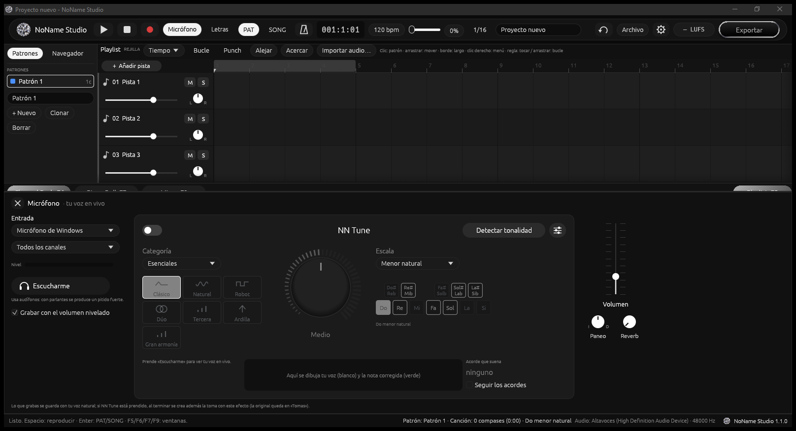
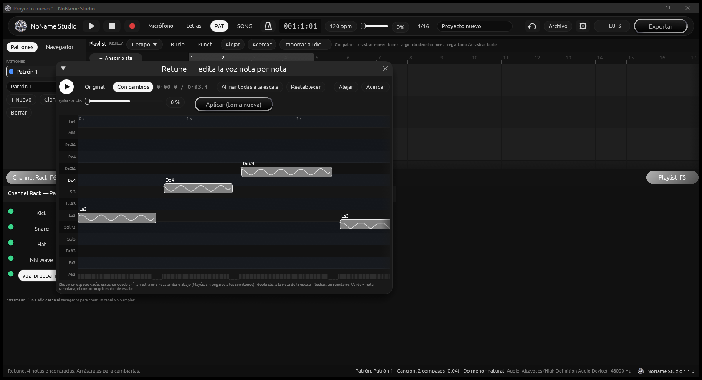

<p align="center">
  
</p>

<h1 align="center">NoName Studio</h1>

<p align="center">
  Estudio de producción musical nativo para <b>Windows</b> y <b>Android</b>.<br>
  Haz beats, graba tu voz con autotune, edítala nota por nota, mezcla y masteriza. Sin suscripciones.
</p>

<p align="center">
  
</p>

## Qué trae

**Componer**
- Channel Rack con secuenciador de pasos, Piano Roll con escalas e imán, arpegiador y swing.
- Instrumentos propios: batería, bajo, Rhodes, pad, campana, **NN Sampler** y el sintetizador **NN Wave** (12 presets).
- 14 golpes de batería sintetizados: Kick, Snare, Clap, Rim, Hi-hat, Open Hat, Tom, Conga, Cowbell, Clave, Snap, Shaker, Ride y Crash.
- Plantillas para empezar rápido: Trap, Reggaetón, Boom bap, House, Lo-fi, Drill y Trap oscuro.
- MIDI: teclado en vivo, importar y exportar archivos `.mid`.
- Plugins **CLAP** como instrumentos y efectos (Windows).

**Pads**
- Toca la batería en vivo, con repetición de nota al ritmo, y graba lo que tocas en el patrón.
- Kits por estilo (Boom bap, Trap 808, Reggaetón, House, Lo-fi y Drill) y botón para volver a como estaban.
- Pad «+» para cargar tus propios audios.
- Varios pads a la vez: con varios dedos en el teléfono o con el teclado en la PC (cada pad muestra su tecla).
- Acordes de la escala que suenan mientras los mantienes apretados.

**Playlist**
- Sigue a la canción mientras suena, deslizándose suave como una cinta.
- Copiar, cortar, pegar, duplicar, dividir y «hacer único» (el clip con su propio patrón).
- Moverse fácil: arrastra el fondo, la regla de compases o la columna de pistas, con inercia; zoom centrado donde apuntas.
- Arrastra un clip al borde y la vista se desplaza sola para llevarlo a cualquier parte.

**Grabar la voz**
- Escúchate mientras grabas, con nivelador automático, paneo y reverb.
- La toma queda tan fuerte y pareja como la escuchaste.
- Tomas por vuelta con bucle y punch, y comping para combinar las mejores partes.

**NN Tune (autotune)**
- 15 estilos en 4 categorías: Esenciales, Hip hop, Hyperpop y Ciencia ficción.
- Corrección precisa: con la voz real queda a 2–3 cents de la nota.
- Sigue los acordes de la canción, muestra la nota que cantas y dibuja tu voz en vivo.
- Se puede grabar con el autotune sin escucharse.

<p align="center">
  
</p>

**Retune y armonías**
- Edita la voz **nota por nota**: arrastra notas, llévalas a la escala y quita el vaivén del tono.
- Compara original y con cambios mientras suena.
- Crea armonías (tercera, quinta u octava) en otra pista con un clic.

<p align="center">
  
</p>

**Mezclar y masterizar**
- Mixer con EQ, compresor, reverb, delay, NN Space y sidechain.
- Pistas con silencio, solo, volumen y paneo.
- Mastering con un clic: estilos **Universal, Fuego, Claridad y Cinta**, con intensidad y graves, medios y agudos.
- **Igualar a una canción de referencia**: copia su volumen y su balance de graves, medios y agudos.
- Medidor de sonoridad (LUFS) y efectos de voz listos (Voz limpia, Rap al frente, Trap brillante…).

<p align="center">
  
  
</p>

**Exportar**
- MP3, WAV (16 o 24 bits) y stems (una pista por canal), con normalización opcional.

**Más**
- Proyectos `.nns` con su propio icono: doble clic en uno y se abre en la app.
- Panel de letras y notas guardado en el proyecto.
- Tutorial interactivo la primera vez y copia de rescate si la app se cierra de golpe.
- Deshacer, versiones del proyecto y ajustes de audio, grabación, exportación y teclas.

## En la PC

Todos los atajos se cambian en **Ajustes > Teclas**. Los de fábrica:

| Acción | Tecla |
|---|---|
| Reproducir / pausar | Espacio |
| Mover la vista de la Playlist | mantener Espacio y arrastrar (o la rueda apretada) |
| Detener | Shift + Espacio |
| Cambiar PAT / SONG | Enter |
| Grabar | Ctrl + R |
| Channel Rack · Piano Roll · Mixer · Pads | F5 · F6 · F7 · F8 |
| Guardar · Guardar como | Ctrl + S · Ctrl + Shift + S |
| Abrir · Nuevo · Deshacer | Ctrl + O · Ctrl + N · Ctrl + Z |
| Exportar MP3 · WAV | Ctrl + E · Ctrl + Shift + E |
| Metrónomo · Bucle · Volver al inicio | M · L · Inicio |
| Micrófono · Letras · Ajustes | Ctrl + M · Ctrl + L · Ctrl + , |
| Acercar · Alejar | + · − |
| Pads 1 a 16 | 1 2 3 4 · Q W E R · A S D F · Z X C V |

En la Playlist: doble clic en un lugar vacío pone el patrón; doble clic en un clip lo edita; clic derecho abre sus opciones; mantener apretada la regla y arrastrar marca el bucle.

## En el teléfono

| Gesto | Qué hace |
|---|---|
| Arrastrar con un dedo | Mueve la vista (Playlist, Channel Rack, Piano Roll y Mixer), con inercia |
| Pellizcar | Acercar o alejar |
| Mantener apretado un clip | Se levanta: arrástralo para moverlo, o suéltalo para ver sus opciones |
| Dos toques seguidos | En un lugar vacío pone el patrón; en un clip lo edita |
| Tocar otra vez la pestaña activa | Vuelve a la Playlist |

Mientras suena, la pantalla no se apaga.

## Descargar

Armado listo para usar en `dist/`:

| Plataforma | Archivo |
|---|---|
| Windows 10 / 11 | `NoNameStudio.exe` (no necesita instalación) |
| Android 8 o más nuevo | `NoNameStudio.apk` |

## Armar desde el código

Hace falta [Rust](https://rustup.rs) estable.

```powershell
# Windows: abrir la app
cargo run --release

# Windows + Android (necesita el SDK y NDK de Android y cargo-apk)
powershell -File tools\armar.ps1
```

## Pruebas

```powershell
cargo run --example features      # comprueba el motor: afinación, Retune, armonías, pistas, exportación…
cargo run --example rendimiento   # mide cuánto procesador usa cada proyecto
cargo run --example convertir -- proyecto.nns.json   # pasa un proyecto viejo al formato .nns
```

## Hecho con

[Rust](https://www.rust-lang.org) · [egui](https://github.com/emilk/egui) · [cpal](https://github.com/RustAudio/cpal) · [symphonia](https://github.com/pdeljanov/Symphonia) · [midir](https://github.com/Boddlnagg/midir) · [CLAP](https://cleveraudio.org)
